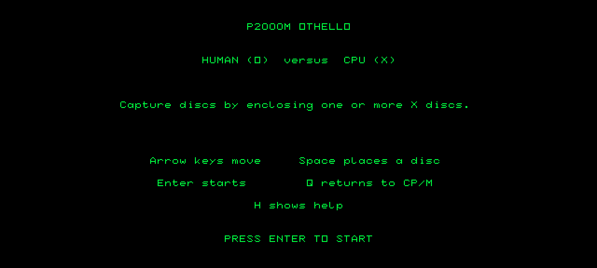
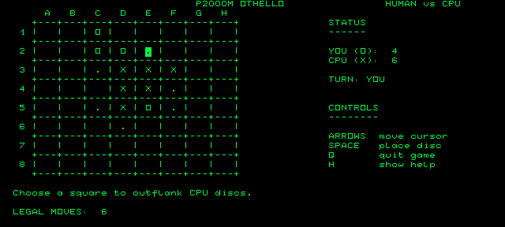
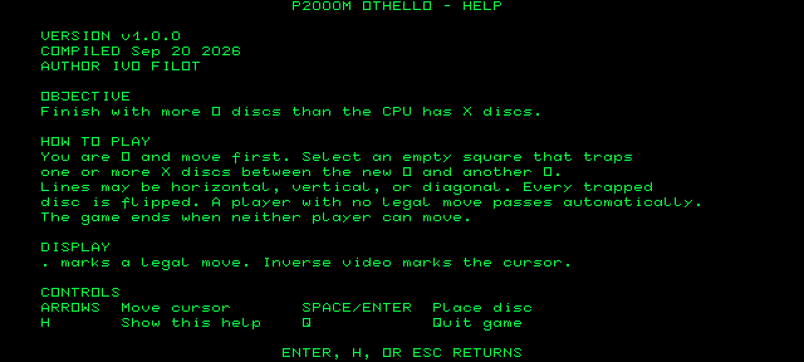

# Othello for the Philips P2000M

[](https://github.com/ifilot/p2000m-othello/actions/workflows/build.yml)
[](https://github.com/ifilot/p2000m-othello/releases)
[](LICENSE)

Othello (Reversi) against the computer, for the Philips P2000M running
[P2000M SD CP/M](https://github.com/ifilot/p2000m-cpm). The game uses the
P2000M's native 80x24 text terminal: the board, the discs, the cursor and the
legal-move markers are all drawn with ordinary characters and inverse video,
so it needs no graphics hardware, sound, files or timers.

> [!NOTE]
> Othello is included on drive **J: GAMES** of the
> [P2000M SD CP/M](https://github.com/ifilot/p2000m-cpm) SD-card image, and
> can be played there in the
> [browser emulator](https://ifilot.github.io/p2000m-cpm/) as well.

<p align="center">
  
  
</p>
<p align="center">
  
</p>

## Play

Run `J:OTHELLO` from the CP/M prompt of the P2000M SD CP/M system. To use a
different build, download `OTHELLO.COM` from the
[releases](https://github.com/ifilot/p2000m-othello/releases) (or the latest
[build artifact](https://github.com/ifilot/p2000m-othello/actions)) and place
it on a CP/M volume with the P2000M SD CP/M image tools.

| Key | Action |
| --- | --- |
| Cursor keys | Move the cursor |
| Space or `RETURN` | Place a disc |
| `H` | Help screen with the rules, version and build date |
| `Q` | Quit to CP/M, after confirmation during a game |
| `RETURN` (title and final screen) | Start a new game |

You play O and move first; the P2000M plays X. Legal moves are marked with a
dot and the cursor is shown in inverse video. A player without a legal move
passes automatically, and the game ends when neither player can move. The
computer plays a deterministic one-ply strategy: it takes the move that flips
the most discs, with a strong preference for corners.

## Build

The program is C, compiled for CP/M with the `z88dk/z88dk` Docker image:

```sh
make build            # -> build/OTHELLO.COM
make test             # rules-engine property tests (host C++ compiler only)
```

`make run` opens the game in the graphical emulator. It uses sibling checkouts
of [p2000m-cpm](https://github.com/ifilot/p2000m-cpm) (cartridge, SD kernel
and image tool) and [p2000m-emulator](https://github.com/ifilot/p2000m-emulator),
creates a disposable SD image with the game on J:, and starts `J:OTHELLO`:

```sh
make run                                   # ../p2000m-cpm and ../p2000m-emulator
make run CPM=/path/to/p2000m-cpm EMULATOR=/path/to/p2000m-emulator
```

## Layout

| File | Contents |
| --- | --- |
| `src/othello.c` | Terminal user interface and application state machine |
| `src/game.c`, `src/game.h` | Platform-neutral rules: legal moves, captures, passes, scoring |
| `src/cpu.c`, `src/cpu.h` | Computer player: greedy flip count with a corner bonus |
| `src/version.h` | Game version shown on the help screen |
| `tests/othello_game.cpp` | Property tests against an independent reference implementation |

The rules engine contains no platform code, so `make test` compiles it as
ordinary host C. The suite compares it with an independent reference
implementation across arbitrary fields and complete randomly played games; a
fixed random seed makes any failure reproducible. The complete game is also
exercised on the emulated machine by the P2000M SD CP/M test suite.

## Continuous integration

The [workflow](.github/workflows/build.yml) builds `OTHELLO.COM` with the
Z88DK Docker image and runs the rules tests on every push and pull request,
and uploads the binary as an artifact. Pushing a `v*` tag that matches
`src/version.h` publishes a GitHub release with `OTHELLO.COM` and a ZIP that
includes the license and this README.

## License

GNU General Public License v3.0; see [LICENSE](LICENSE).
